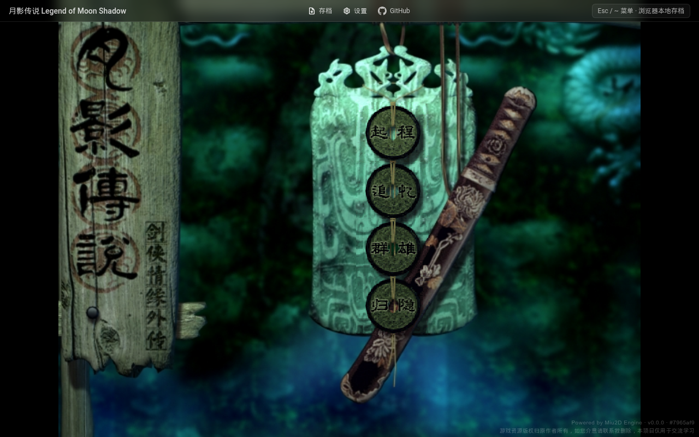
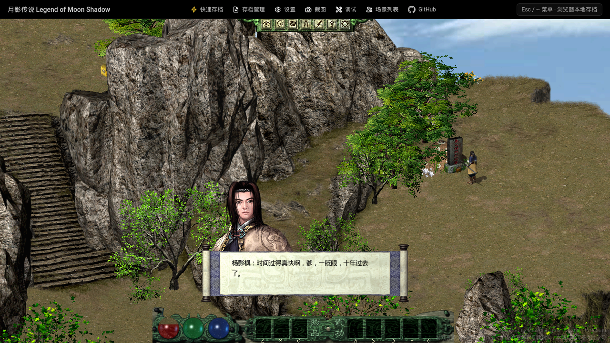

# 《剑侠情缘外传：月影传说》(2001) WebAssembly + WebGL 网页重制版

[-blue?style=for-the-badge)](https://github.com/kunruiw1991/moonshadow-online)

> 西山居经典武侠巅峰巨作《剑侠情缘外传：月影传说》（2001）纯前端 WebAssembly + WebGL 网页重制版。无需安装任何插件或客户端，打开浏览器即可即时体验杨影枫的江湖恩怨与多种经典结局。

🎮 **在线游玩地址**：[https://kunruiw1991.github.io/moonshadow-online/](https://kunruiw1991.github.io/moonshadow-online/)  
📦 **原版完整无损镜像仓库**：[https://github.com/kunruiw1991/jxqy-moonshadow](https://github.com/kunruiw1991/jxqy-moonshadow)

---

## 🌟 游戏截图

### 游戏标题主界面

### 凌绝峰峰顶 开场实机画面

---

## ✨ 核心特性

1. **100% 静态纯前端渲染 (Serverless)**
   - 基于 WebAssembly + WebGL / 2D Canvas 混合渲染引擎。
   - 所有静态地图资源、NPC 数据、物件配置均静态化分发，无任何后端依赖与数据库开销。

2. **完整音画沉浸体验**
   - 包含高清开场与制作群过场动画（WebM 格式）。
   - 收录全部 28 首经典原声 CD 音轨（《爱的废墟》、《天仙子》等 `mc000.mp3`..`mc075.mp3`），支持 HTTP Range 流式分段缓冲。
   - 还原原版全部 4,371 个贴图、角色动作、武功特效、法术与环境音效。

3. **专为 iPad 与便携键盘优化**
   - 针对 iPad 妙控键盘 (Magic Keyboard) 等无独立 `Esc` 键的外接键盘，**深度映射 `` ~ / ` `` (Backquote) 键与 `Esc` 完全等效**。
   - 在主界面、过场视频跳过、对话推进、游戏菜单与存档面板中均可使用 `` ~ / ` `` 一键唤起与关闭。

4. **浏览器本地 IndexedDB 存档管理器**
   - **无限档位**：支持本地 IndexedDB 持久化存储，无需账号或云端同步。
   - **存档快照**：自动记录当前地图名、角色名、等级、时间戳与缩略图。
   - **智能自动存档**：支持每 5 分钟定时自动存档与窗口失焦/切台前自动存档。
   - **跨设备备份**：提供一键导出 `.json` 存档文件与本地 `.json` 导入功能，存档自由迁移。

5. **经典 UI 像素级还原**
   - 原版标题界面四枚 ASF 动态按钮（`新的开始`、`旧的回忆`、`制作群`、`离开游戏`）由 WASM Worker 动态解析 MSF 帧缓冲呈现。

---

## ⌨️ 操作指南

| 动作 | 电脑键盘 / 鼠标 | iPad 触控 / 外接键盘 |
| :--- | :--- | :--- |
| **移动 / 行走 / 奔跑** | 鼠标左键点击或按住拖拽 / **方向键 (`↑` `↓` `←` `→`)** / **`W` `A` `S` `D`**（按住 `Shift` 切换奔跑） | 屏幕触控点击或拖拽地面 / 外接键盘方向键或 WASD |
| **主武功 / 攻击** | 鼠标右键点击目标 / 鼠标直接点击底部技能栏 | 屏幕触控点击底部技能图标 / 外接按键 |
| **武功技能快捷键** | **`1` `2` `3` `4` `5`**（对应武功栏 1-5 槽，支持 `J` `K` `L` `F` `G`） | 触控屏幕技能格子 / 外接数字键 `1`-`5` |
| **道具快捷栏** | `Z` `X` `C` 快捷使用底部道具 1/2/3 槽 | 触控屏幕底部物品格子 / 外接 `Z` `X` `C` |
| **快捷交互** | `Q` 交互最近物品 / `E` 交互最近 NPC | 触控屏幕 NPC / 外接 `Q` `E` 键 |
| **打坐调息** | `V` 键切换打坐与起立 | 触控状态面板 / 外接 `V` 键 |
| **功能面板** | `F1` 属性 / `F2` 道具 / `F3` 武功 / `F4` 系统 / `Tab` 小地图 | 顶部工具栏图标 / 外接功能键 |
| **系统菜单 / 存档** | `Esc` 键 | **`` ~ / ` `` 键** 或 顶部工具栏「⚡ 存档管理」 |
| **快速存档** | 顶部工具栏「⚡ 快速存档」 | 顶部工具栏「⚡ 快速存档」 |
| **对话推进 / 拾取** | 鼠标左键 / `Space` / `Enter` / 选项数字 `1`-`2` | 触控屏幕对话区域 / `Space` / `Enter` |
| **视频跳过** | `Esc` / 右下角「跳过」按钮 | **`` ~ / ` ``** 或 右下角「跳过」按钮 |

---

## 🛠️ 技术架构

- **Runtime**: WebAssembly (Rust compiled WASM) + WebGL Canvas
- **UI Framework**: React 19 + Tailwind CSS + Lucide Icons
- **Audio/Video Engine**: HTML5 Audio (RFC 7233 Range Streaming) + WebM Video Player
- **Storage Layer**: IndexedDB (`moonshadow_saves_db`) + File API JSON Exporter/Importer
- **Build & Bundle**: Vite + Rolldown

---

## 📜 版权与说明

1. 本项目仅供技术研究、数字化文化遗产保护与个人交流学习使用。
2. 游戏原案、剧情、美术素材、音乐音效之全部版权均归属于**西山居（Kingsoft Seasun）**及原制作团队。
3. 请支持国产武侠正版软件。
